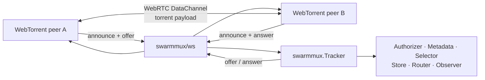

# SwarmMux

[](https://github.com/GyeongHoKim/swarmmux/actions/workflows/ci.yml?query=branch%3Amain)
[](https://go.dev/)
[](https://pkg.go.dev/github.com/GyeongHoKim/swarmmux)

**Build custom WebTorrent trackers with SwarmMux.**

SwarmMux is a Go SDK for running a WebTorrent tracker inside your own application. It
implements the tracker protocol, WebSocket signaling, swarm membership, peer discovery,
offer/answer routing, and scrape statistics — and hands you an extension point for every
policy decision it refuses to make for you.

It is **not** a standalone tracker daemon. Your application owns the server, deployment,
authentication, persistence, and observability.

## Quick start

```bash
go get github.com/GyeongHoKim/swarmmux@latest
```

Requires **Go 1.24 or later**.

```go
package main

import (
    "log"
    "net/http"
    "time"

    "github.com/GyeongHoKim/swarmmux"
    swarmws "github.com/GyeongHoKim/swarmmux/ws"
)

func main() {
    var tracker swarmmux.Tracker // the zero value is a working tracker

    mux := http.NewServeMux()
    mux.Handle("GET /announce", swarmws.NewHandler(&tracker))

    server := &http.Server{
        Addr:              ":8080",
        Handler:           mux,
        ReadHeaderTimeout: 5 * time.Second,
    }

    log.Printf("WebTorrent tracker listening on %s", server.Addr)
    log.Fatal(server.ListenAndServe())
}
```

WebTorrent clients can now use `ws://localhost:8080/announce`. Use `wss://` in production.

No configuration, no database, no broker: the defaults are in-memory. SwarmMux does not
create or own the `http.Server`; it returns a handler you mount in the application you
already operate.

## Why SwarmMux?

Most BitTorrent and WebTorrent tracker projects are complete server applications. They
decide how the process starts, which ports it listens on, how configuration is loaded,
how state is stored, and how the service is deployed.

SwarmMux is library-first. It owns the tracker control plane; you own everything else,
through a named interface for each decision:

| You decide | Extension point |
|---|---|
| How the HTTP server is created and deployed | your `net/http` code |
| How WebSocket upgrade requests are authenticated | ordinary HTTP middleware |
| Which identities may join each swarm | [`Authorizer`](docs/extension-points.md#authorizer) |
| Which application data rides along with an announce | [`Metadata`](docs/extension-points.md#metadata) |
| How peers are matched to each other | [`Selector`](docs/extension-points.md#selector) |
| Where swarm membership and statistics are stored | [`Store`](docs/extension-points.md#store) |
| How signaling is routed across tracker instances | [`Router`](docs/extension-points.md#router) |
| How per-connection rate limits are enforced | [tracker middleware](docs/transport.md#rate-limiting) |
| How metrics, traces, and logs are exported | [`Observer`](docs/extension-points.md#observer) |

Every one of them is optional and has a working default.



Torrent payloads never pass through the tracker. SwarmMux carries the control plane; peers
exchange data directly over WebRTC DataChannels once signaling completes.

## Features

- WebTorrent WebSocket tracker protocol, with a built-in transport for standard clients
- Zero-configuration in-memory operation — the zero value is a working tracker
- Announce, scrape, and WebRTC offer/answer relay
- Multiple swarm memberships over a single WebSocket connection
- Horizontal scale-out through a replaceable `Router`
- Peer-identity binding that rejects `peer_id` hijacking
- Bounded outbound queues with an explicit overflow policy
- Session cleanup on disconnect, and peer expiration via `PeerTTL`
- Application-defined, validated announce metadata
- Conformance suites for trackers, stores, and routers
- Bring your own storage and messaging — SwarmMux never opens a database, cache, or
  broker connection

## Documentation

| Document | Read it when you want to |
|---|---|
| [Architecture](docs/architecture.md) | understand `Tracker`, `Handler`, `Session`, the `Store`/`Router` split, context propagation, and shutdown |
| [Extension points](docs/extension-points.md) | implement `Authorizer`, `Metadata`, `Selector`, `Store`, `Router`, or `Observer` |
| [Attaching infrastructure](docs/adapters.md) | wire the Redis adapter or your own backend behind `Store` and `Router`, and know who closes what |
| [WebSocket transport](docs/transport.md) | tune the `ws` handler, set origin policy and backpressure, or add tracker middleware |
| [Protocol behavior](docs/protocol.md) | know what clients see: compatibility, failure responses, peer identity |
| [Security](docs/security.md) | harden a deployment that faces the Internet |
| [Testing](docs/testing.md) | run the conformance suites for a tracker, store, or router |

## Scope

SwarmMux does **not** provide:

- a standalone tracker daemon or CLI-first deployment model
- classic HTTP or UDP tracker endpoints (BEP 3 / BEP 15), DHT, or PEX — WebTorrent
  WebSocket only
- torrent piece storage or transfer
- a WebRTC implementation, or a STUN or TURN server
- user management, billing, or subscription logic
- database connection ownership
- a globally optimal swarm-topology algorithm

SwarmMux provides the building blocks for your tracker service; the embedding application
owns service-specific infrastructure and policy.

## Package layout

| Package | Purpose |
|---|---|
| `github.com/GyeongHoKim/swarmmux` | Tracker engine, domain types, extension interfaces, and the default in-memory `Store` and `Router` |
| `github.com/GyeongHoKim/swarmmux/protocol` | WebTorrent tracker wire messages, validation, identifiers, and JSON codec |
| `github.com/GyeongHoKim/swarmmux/ws` | WebSocket transport and `net/http` handler |
| `github.com/GyeongHoKim/swarmmux/trackertest` | Fake sessions, WebSocket test server, fixtures, and the tracker/store/router conformance suites |
| `github.com/GyeongHoKim/swarmmux/internal/...` | Session bookkeeping, queues, and other implementation details |

SwarmMux ships two backends: the in-memory defaults, and a **Redis companion module**
with its own `go.mod` that covers both `Store` and `Router`. Anything else — Postgres,
NATS, DynamoDB — you write against the same interfaces, with a conformance suite to check
it. An application on the in-memory defaults never builds a Redis client.

## Examples

Complete examples are available under [`examples/`](examples/):

- `examples/basic` — minimal WebTorrent tracker
- `examples/authorization` — WebSocket authentication and swarm authorization
- `examples/custom-selector` — application-aware peer selection
- `examples/custom-store` — external swarm membership storage
- `examples/scale-out` — multi-instance deployment with a custom `Router`
- `examples/observability` — metrics and structured logging
- `examples/graceful-shutdown` — coordinated server and tracker shutdown

## Contributing

Issues and pull requests are welcome. Start with the
[architecture overview](docs/architecture.md) to see how the engine, transport, and
[extension points](docs/extension-points.md) fit together.

The toolchain is pinned in `mise.toml`, so one command gets you a matching
environment — Go, the linter, the task runner, and the git hooks:

```bash
mise install    # or: install mise from https://mise.jdx.dev
just setup
```

Before submitting a change:

```bash
just format
just lint
just test
```

`just ci` runs the same checks CI does, in the same order. There is also a
[dev container](.devcontainer/devcontainer.json) if you would rather not install anything.

Commit messages follow [Conventional Commits](https://www.conventionalcommits.org/) and are
checked by the `commit-msg` hook and again on every pull request. The type is not
cosmetic: release automation derives the next version from it.

```text
feat(ws): add overflow policy option
fix: release peer binding on stopped event
```

Protocol changes should include conformance fixtures and interoperability coverage against
the reference [`webtorrent/bittorrent-tracker`](https://github.com/webtorrent/bittorrent-tracker)
implementation. See [Testing](docs/testing.md) for the conformance suites.

## Versioning

SwarmMux follows [Semantic Versioning](https://semver.org/).

Releases are cut by [release-please](https://github.com/googleapis/release-please) from the
Conventional Commit history: it maintains a release pull request with the changelog, and
merging it tags the commit and publishes the GitHub Release.

Breaking changes to the public API arrive only in a new major version, and are documented
in the release notes with migration guidance.

## License

SwarmMux is licensed under the [Apache License 2.0](LICENSE).

Apache-2.0 grants an explicit patent license alongside the copyright license, which matters
for a signaling component in the patent-dense WebRTC and streaming space. Redistributions
must carry the [NOTICE](NOTICE) file along with the license.
