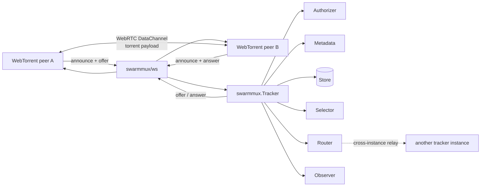

# Architecture

How the pieces of SwarmMux fit together, and the contracts that hold between them.

- [How it fits together](#how-it-fits-together)
- [Store and Router are different things](#store-and-router-are-different-things)
- [Tracker](#tracker)
- [Handler](#handler)
- [Session](#session)
- [Context propagation](#context-propagation)
- [Identifiers and events](#identifiers-and-events)
- [Graceful shutdown](#graceful-shutdown)

## How it fits together



The WebSocket connection is required by standard browser WebTorrent clients for both
tracker communication and WebRTC signaling.

Torrent payloads never pass through the tracker. SwarmMux carries the control plane; peers
exchange data directly over WebRTC DataChannels once signaling completes.

SwarmMux separates the tracker engine from the concrete WebSocket implementation so that
the engine can be tested without opening sockets, and so advanced users can supply their
own session adapter. That is an extensibility boundary, not a second WebTorrent transport
protocol.

## Store and Router are different things

This split is the most important concept in the SDK.

|  | `Store` | `Router` |
|---|---|---|
| Holds | swarm membership, statistics | live peer → session bindings |
| Lifetime | may outlive the process | bound to process lifetime |
| Shared across instances | yes, if you want | yes, if you want to scale out |
| Backed by | memory, Redis, SQL, anything | memory, Redis Pub/Sub, NATS, anything |
| Answers | "who is in this swarm?" | "how do I hand this message to that peer?" |
| Shut down by | nothing — it owns no goroutines | `Tracker.Shutdown`, through `Close` |

Neither owns its connection. The application opens the client, assigns it, and closes it
after `Tracker.Shutdown` returns.

A single-instance tracker needs neither: the defaults are in-memory and require no
configuration. A multi-instance deployment usually replaces **both**, and they do not have
to use the same backend.

See [`Store`](extension-points.md#store) and [`Router`](extension-points.md#router) for the
full interfaces and their implementation contracts.

## Tracker

`Tracker` is the main entry point.

```go
type Tracker struct {
    Store      Store       // membership + statistics
    Router     Router      // live signaling routing
    Selector   Selector    // peer selection policy
    Authorizer Authorizer  // per-swarm authorization
    Metadata   Metadata    // announce extension decoding + validation
    Observer   Observer    // metrics and tracing

    AnnounceInterval    time.Duration // interval advertised to clients
    PeerTTL             time.Duration // membership expiry for silent peers
    MaxOffers           int           // offers accepted per announce
    MaxSwarmsPerSession int           // swarms one connection may join
    MaxPeersPerAnnounce int           // upper bound on numwant

    Logger *slog.Logger
}
```

The zero value is ready to use:

```go
var tracker swarmmux.Tracker
```

Unset fields fall back to defaults: an in-memory store, an in-memory single-process
router, random peer selection, a permissive authorizer, no metadata decoding, and a no-op
observer.

### Configuration idiom

SwarmMux uses two configuration styles, on purpose, split along a clear boundary:

- **Core engine — exported struct fields.** `Tracker` follows the same contract as
  `http.Server`: set fields **before first use**, then never mutate or copy it. Values
  read after the tracker starts serving are not guaranteed to be observed.
- **Transport — constructor plus functional options.** `swarmws.NewHandler` takes options
  so transport tuning can grow without breaking existing call sites.

## Handler

The tracker engine accepts a live tracker session through `Handler`.

```go
type Handler interface {
    ServeTracker(context.Context, Session) error
}

type HandlerFunc func(context.Context, Session) error
```

`*Tracker` implements `Handler`.

A handler invocation represents the lifetime of **one tracker connection**, not a single
request/response exchange. This matters because one WebSocket connection may carry
announces for multiple swarms, and one announce can cause messages to be routed to other
connected peers.

Wrapping a `Handler` is how you add logging, rate limiting, or any other per-connection
behavior — see [tracker middleware](transport.md#tracker-middleware).

## Session

`Session` is the boundary between the tracker engine and a live bidirectional connection.

```go
type Session interface {
    ID() SessionID
    RemoteAddr() net.Addr

    Receive(context.Context) (protocol.Message, error)
    Send(context.Context, protocol.Message) error

    // Close terminates the connection. cause may be nil for a normal close.
    // Close is idempotent and safe to call concurrently with Receive and Send.
    Close(cause error) error
}
```

`protocol.Message` is a decoded tracker message — an announce, scrape, offer, answer, or
failure — defined in the `protocol` package.

Most applications never implement `Session`; the `ws` package provides the standard
WebSocket implementation. The abstraction exists so the engine can be tested in memory, so
WebSocket library details do not leak into the core API, and so advanced integrations can
supply a compatible session.

Wrapping a `Session` is, however, a supported and useful technique — see
[rate limiting](transport.md#rate-limiting).

## Context propagation

The context passed to `ServeTracker` carries:

- **Values** from the HTTP upgrade request's context. Anything your authentication
  middleware attached with `context.WithValue` is visible to `Authorizer`, `Metadata`,
  `Selector`, and `Store`.
- **Cancellation** tied to the **connection** lifetime, not the HTTP request lifetime. It
  is canceled when the peer disconnects or when `Tracker.Shutdown` begins.

Store and router calls receive a context derived from the session context, so a disconnect
cancels in-flight backend work.

## Identifiers and events

```go
type InfoHash [20]byte
type PeerID   [20]byte
type OfferID  [20]byte

type SessionID string // opaque, unique per live connection

type AnnounceEvent uint8

const (
    EventUpdated   AnnounceEvent = iota // periodic re-announce (empty event field)
    EventStarted
    EventCompleted
    EventStopped
)
```

## Graceful shutdown

The application controls both HTTP-server and tracker lifecycle.

```go
ctx, cancel := context.WithTimeout(context.Background(), 10*time.Second)
defer cancel()

if err := server.Shutdown(ctx); err != nil {
    log.Printf("HTTP shutdown: %v", err)
}

if err := tracker.Shutdown(ctx); err != nil {
    log.Printf("tracker shutdown: %v", err)
}
```

`Tracker.Shutdown`:

1. stops accepting new sessions — subsequent `ServeTracker` calls return `ErrShutdown`;
2. cancels every active session context;
3. calls `Close` on each active session;
4. stops the expiry loop and unbinds sessions from the `Router`;
5. waits for all handler invocations to return, or for the context to expire;
6. calls `Router.Close`.

`Router.Close` comes last because a handler that is still unwinding may yet call `Route`.
The `Store` has no `Close`: it owns no goroutines, and the connection behind it belongs to
the application.

Draining the outbound queue and sending the WebSocket close frame is the **transport's**
responsibility. `swarmws` flushes queued messages up to `WithWriteTimeout` before closing
the underlying connection.

`Shutdown` is idempotent and safe to call concurrently. Shut the HTTP server down first so
no new upgrades arrive mid-drain.
